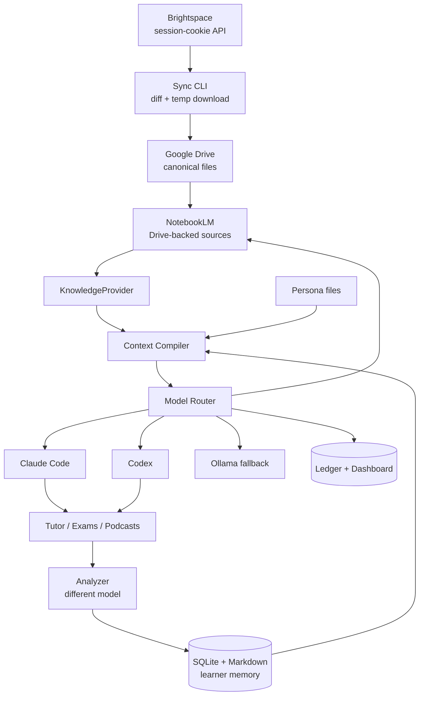

# BrightLearn — Master Spec

Sep 23, 2026 · @Simon

## What we're building

BrightLearn is a personal learning platform that pulls every course file out of Brightspace, grounds an AI in that material, and remembers what the student actually knows over months and years. It uses NotebookLM for source-grounded intelligence, Claude Code and Codex for reasoning, Google Drive as the canonical filesystem, and its own SQLite + Markdown memory for learner state.

The product is not "chat with your course PDFs." Three things make it different:

- **Continuity.** A learner model with mastery, misconceptions, evidence and retention that persists across sessions, courses and semesters. This is the moat; every feature reads from and writes to it.
- **Adaptivity.** Practice exams, tutoring and podcasts are shaped by what the syllabus says is on the exam and what this specific learner has not yet demonstrated.
- **Personas, not agents.** Teaching and assessment strategies (Simplifier, Analogist, Exemplar, Challenger, Analyzer, Critic) run as bounded tasks on whichever model is best at them, with at most one or two rounds of cross-model deliberation.

V1 is a personal prototype for one student at Stony Brook, running entirely on existing subscriptions with no metered LLM API spend. The architecture keeps every external dependency behind an interface so the same system can later move to API-backed inference for other users.

## Core principles

These are the rules every design decision has to pass. If a proposal breaks one, it needs an explicit entry in the decision log.

1. **No dependency that charges per request.** "Avoid APIs" means avoid metered LLM APIs while validating the product. Free official APIs (Google Drive) and session-cookie endpoints (Brightspace) are fine. Claude, Codex and NotebookLM run on subscription quota.
2. **Every external dependency lives behind an interface.** Nothing outside `core/providers/` imports notebooklm-py, Playwright, or a Drive SDK. If Google breaks the unofficial NotebookLM interface, one provider directory changes; tutoring, exams, memory and personas do not.
3. **Don't delete anything; retrieve selectively.** Full history goes to archive memory. Only a compiled context package of a few thousand tokens reaches a model. Quota is saved through retrieval discipline, not compression.
4. **Mastery needs evidence.** No score without the interactions that justify it. The Analyzer changes a score only when new evidence warrants it.
5. **Infer learning from normal interaction.** No forced quizzes. Explaining, solving and asking are all evidence.
6. **Teaching and evaluation run on different models.** The model that tutored a session never grades it.
7. **Bounded deliberation.** Single-model execution by default. Cross-model rounds only where they add value, capped at two.
8. **Measure model strengths; never decree them.** Task routing comes from a benchmark table the system fills in, not from hardcoded "Claude explains, Codex writes questions."
9. **Course coverage and learner coverage are separate.** "The professor taught it" and "the student demonstrated it" are different tables.
10. **Our own ledger is the source of truth for usage.** Provider telemetry is a hint; every model call is logged locally.
11. **Subscriptions power the prototype, not a product.** Anthropic and OpenAI both direct products-for-others to API keys. The `ModelProvider` interface exists so that swap costs nothing later.

## Features

Nine subsystems. Each is a standalone CLI or library module that can be used on its own, but all of them read and write the same memory store.

| # | Subsystem | What it does for the learner | Depends on |
| --- | --- | --- | --- |
| 1 | **Brightspace → Drive sync** | Discovers every course resource, downloads only new or changed files to a temp dir, uploads to a structured Drive folder, deletes the temp copy. Zero permanent local storage. | Brightspace session, Drive API |
| 2 | **Knowledge layer** | Imports Drive files into a NotebookLM notebook per course as Drive-backed sources so they auto-sync. Exposes grounded Q&A, full source text, quiz/flashcard/report/slide/audio generation. | Sync manifest, NotebookLM |
| 3 | **Learner memory** | SQLite for machine truth (mastery 0–5, confidence, evidence count, retention) and a Markdown vault for readable notes (misconceptions, history, relationships). Archive keeps everything; active memory is what gets retrieved. | — |
| 4 | **Context Compiler** | Turns a question into a minimal package: intent → concepts → relevant source answer + relevant learner rows + persona + last few turns. Target is \~3k tokens in, not 150k. | 2, 3 |
| 5 | **Tutor + personas** | Interactive tutoring using teaching personas (Simplifier, Analogist, Exemplar) and assessment personas (Questioner, Challenger, Analyzer, Critic). Personas are Markdown skill files loadable by both Claude Code and Codex. | 4, Model Router |
| 6 | **Analyzer (passive mastery tracking)** | After each session, a different model reads the transcript, extracts evidence events (explained / applied / transferred / failed), and proposes learner-model updates. Disagreement with the tutor triggers a Challenger probe, not an average. | 3, 5 |
| 7 | **Practice Exam Engine** | Reads an editable `ExamSpec` (weeks, formats, difficulty, include/exclude), plans coverage from syllabus + study guides, generates grounded questions, critiques once on a second model, exports. Modes: realistic, weakness, challenge, diagnostic. Grading writes evidence back. | 2, 3, Model Router |
| 8 | **Adaptive Podcast Engine** | Compiles learner state + exam coverage into a custom instruction file and passes it to NotebookLM Audio Overview. Each episode differs because the learner model changed. Tags concepts so later evidence closes the loop. | 2, 3, 4 |
| 9 | **Model Router + Usage Dashboard** | Task-typed routing across Claude / Codex / NotebookLM / local Ollama with health states and per-task fallback chains. Local ledger of every call. One HTML page showing usage, failures, and the benchmark table. | All |

## Technology stack

Everything in the prototype is free at our scale or already paid for through a subscription.

| Component | Technology | Role | Stability | Cost to us |
| --- | --- | --- | --- | --- |
| Course ingestion | Playwright (login + session) calling Brightspace `/d2l/api/le/1.97/...` endpoints with session cookies | Structured TOC, topic metadata, direct file download. Verified working Sept 23, 2026 on SBU. | High. Same endpoints the Brightspace UI itself uses. | $0 |
| Ingestion fallback | Playwright DOM scraping | Only if a specific endpoint 403s for students | Medium-high | $0 |
| Canonical storage | Google Drive REST API (OAuth desktop client) | Structured `BrightLearn/{term}/{course}/{bucket}/` tree, file IDs for downstream | Very high, official | $0 below Google's billing threshold |
| Grounded intelligence | Gemini Notebook (NotebookLM) via `teng-lin/notebooklm-py` | Source Q&A, full text, quizzes, flashcards, reports, slides, Audio Overview with custom instructions | Product: high. Library: medium, unofficial. | Google plan quota (compute-based, resets every 5 h) |
| NotebookLM transport | Android/gRPC backend (primary), web batchexecute (fallback) | Master token → short-lived bearer → protobuf. Cleaner than cookie + obfuscated RPC. | Medium, reverse-engineered | $0 |
| Reasoning model A | Claude Code on Pro/Max subscription | Tutoring, explanation, critique, coding | High for prototype | Subscription quota |
| Reasoning model B | Codex CLI on ChatGPT subscription (GPT-5.6 Terra / Luna) | Question generation, evaluation, coding | High for prototype | Subscription quota |
| Local fallback | Ollama | Classification, metadata extraction, context selection, housekeeping when cloud quota is gone | Very high | $0 |
| Tool interop | MCP (Drive MCP, NotebookLM MCP, our own BrightLearn MCP) | Lets Claude Code and Codex call our tools and NotebookLM directly | High and growing; NotebookLM MCP is experimental | $0 |
| Structured learner state | SQLite | Mastery, evidence, manifest, ledger, benchmarks | Extremely high | $0 |
| Readable memory | Markdown vault (Obsidian-compatible, Git-versioned) | Concept notes, misconceptions, session summaries, persona definitions | Extremely high | $0 |
| Dashboard | Single local HTML page reading SQLite | Usage, health, benchmarks | Extremely high | $0 |
| Backend language | Python | Sync, providers, memory, router, CLIs | — | $0 |

What we are **not** using in V1: vector databases, our own embeddings or RAG pipeline, our own PDF parser or TTS, microservices, Redis, Kubernetes, metered LLM APIs. NotebookLM supplies the retrieval and generation infrastructure for free at this stage; building it ourselves would cost months without changing what the learner experiences.

## Architecture and data flow

One core library, three thin CLIs (`sync`, `exam`, `tutor`), one shared memory store. The Context Compiler is the intelligence layer; the Model Router is the only thing that talks to a model.



Read it top-down: course files flow in once and stay in Drive; every learner interaction flows through the compiler and router and ends by writing evidence back to memory, which changes the next interaction.

**Ingestion path.** Playwright holds a persistent browser profile. On each run it calls `whoami`; a 200 means proceed headless, a redirect opens a visible window for you to log in and approve Duo, then continues. The tool walks `content/toc` for each enrolled course, diffs `TopicId` + `LastModifiedDate` against the manifest, downloads changed `File` topics to `/tmp/brightlearn/{uuid}`, uploads to Drive with a resumable upload, verifies the hash, deletes the temp file, and records the Drive file ID. `Link` topics (Zoom recordings) are recorded as metadata, not downloaded. Real filenames come from `Content-Disposition`, not the topic title.

**Knowledge path.** For each new Drive file ID, the provider calls NotebookLM's *Drive source* import (never the generic file upload), so the source stays linked and auto-syncs when Drive changes. The manifest stores `notebook_id` and `notebook_source_id` alongside the Brightspace and Drive IDs.

**Learning path.** A question or session enters the Context Compiler, which resolves intent → concepts, pulls a grounded answer from NotebookLM, pulls the relevant learner rows and misconception notes, attaches the selected persona file and the last few turns, and hands a small package to the Router. The Router picks a provider by task type, health state and benchmark score, logs the call, and returns. After the session the Analyzer runs on a different provider and writes evidence to memory.

**Four context classes** the compiler draws from: source context (Drive + NotebookLM: what the course says), learner context (SQLite + vault: what the student knows), session context (temporary: what we're doing now), instructional context (persona files: how to teach it).

**Repo layout**

```
brightlearn/
├── core/
│   ├── providers/
│   │   ├── lms/          # BrightspaceSessionProvider, BrightspaceScrapeProvider
│   │   ├── storage/      # GoogleDriveBackend
│   │   ├── knowledge/    # GeminiNotebookProvider (android + web transports)
│   │   └── models/       # ClaudeCodeProvider, CodexProvider, OllamaProvider
│   ├── memory/           # schema, vault I/O, archive vs active
│   ├── context/          # Context Compiler
│   ├── router/           # task routing, health, fallback, benchmarks
│   └── ledger/           # every model call
├── personas/             # Markdown skill files shared by Claude Code + Codex
├── cli/                  # sync.py, exam.py, tutor.py
├── dashboard/            # local HTML over SQLite
└── memory/               # the vault (secrets and browser profile gitignored)
```

## Data model

SQLite holds machine truth; the Markdown vault holds the readable story. Five tables carry the system.

**`resources` (the manifest and traceability spine).** One row per Brightspace topic. Primary key is `topic_id`.

```
course, org_unit_id, topic_id (PK), module_path, title, type_identifier (File|Link),
filename, size, last_modified, hash, drive_file_id, drive_bucket,
notebook_id, notebook_source_id, sync_state (pending|synced|stale|failed), last_seen
```

**`concepts` and `mastery`.** Concepts are the nodes of the course graph; mastery is what this learner has shown per concept.

```
concepts: concept_id (PK), course, name, module, prerequisites[], exam_tags[]
mastery:  concept_id, level (0-5), confidence (0-1), evidence_count,
          last_evidence_at, retention_confidence, last_reviewed
```

Mastery levels: 0 unseen · 1 exposed (recognizes terms) · 2 explained (can explain accurately) · 3 applied (solves a standard problem) · 4 transferred (solves an unfamiliar variant) · 5 retained (still demonstrates it later). Retention confidence decays with time since last evidence; the level itself does not.

**`evidence`.** Append-only. Every mastery change points at rows here.

```
evidence_id, concept_id, session_id, type (explained|applied|transferred|failed|misconception),
strength (weak|moderate|strong), source_provider, excerpt_ref, recorded_at
```

**`model_runs` (the ledger).**

```
run_id, provider, model, task_type, persona, started_at, duration_ms, success,
input_tokens_est, output_tokens_est, fallback_from, error
```

**`benchmarks`.** Filled by the system, read by the router.

```
provider, task_type, accuracy, groundedness, format_compliance, latency_ms, learner_rating, sample_count
```

**Markdown vault.** One note per concept, session and misconception, with YAML front matter that mirrors the SQLite row so both stay greppable.

```
memory/
├── learner/profile.md            # preferences: examples-first, analogy-friendly, etc.
├── courses/CSE220/               # syllabus summary, exam calendar, coverage by week
├── concepts/pointer-arithmetic.md
├── misconceptions/ptr-plus-one-is-one-byte.md
├── sessions/2026-09-23-1430.md   # compressed summary + evidence extracted
└── personas/                     # symlink to /personas
```

**`ExamSpec` (editable YAML, one per exam).**

```yaml
course: CSE220
exam: Midterm 1
weeks: [1, 2, 3, 4, 5]
sources: [syllabus, study-guides, lectures]
formats: {multiple_choice: 10, short_answer: 5, coding: 3}
difficulty: {easy: 20, medium: 50, hard: 30}
mode: realistic          # realistic | weakness | challenge | diagnostic
include: [data representation, pointers]
exclude: [file I/O]
```

**Podcast context (generated Markdown, passed to NotebookLM as `--prompt-file`).** Built by the Context Compiler from `mastery`, `misconceptions`, the upcoming `ExamSpec`, and `learner/profile.md`. It tells NotebookLM what to skip, what to dwell on, which misconception to confront, and how to end.

## Provider interfaces

Four contracts. Everything above them is provider-agnostic; everything below them can be swapped.

```python
class LMSProvider:
    def ensure_session() -> None            # headless if valid, headed login + Duo pause if not
    def list_courses() -> list[Course]      # from myenrollments
    def list_resources(org_unit_id) -> list[Resource]   # flattened TOC
    def download(resource, dest_path) -> DownloadResult  # filename from Content-Disposition

class StorageBackend:
    def ensure_folder(path) -> folder_id
    def upload(local_path, folder_id, resumable=True) -> file_id
    def verify(file_id, expected_hash) -> bool
    def list(folder_id) -> list[FileMeta]

class KnowledgeProvider:
    def ensure_notebook(course) -> notebook_id
    def add_drive_source(notebook_id, drive_file_id) -> source_id   # no local-path variant in V1
    def refresh_source(source_id) -> None
    def query(notebook_id, question, source_ids=None) -> GroundedAnswer
    def source_fulltext(source_id) -> str
    def generate_quiz(notebook_id, spec) -> QuizJSON
    def generate_audio(notebook_id, instructions_md, format, length) -> mp3_path
    def generate(notebook_id, kind, options) -> ArtifactPath      # slides, report, flashcards, mind map
    def health() -> ProviderState

class ModelProvider:
    def run(task: TaskPackage) -> ModelResult   # task carries type, persona, context package
    def health() -> ProviderState
    def usage_hint() -> UsageHint | None        # /status, limit errors, etc.
```

**Implementations in V1**

| Interface | Primary | Fallback |
| --- | --- | --- |
| `LMSProvider` | `BrightspaceSessionProvider` (Playwright + `/d2l/api` calls) | `BrightspaceScrapeProvider` (Playwright DOM) |
| `StorageBackend` | `GoogleDriveBackend` | — |
| `KnowledgeProvider` | `GeminiNotebookProvider` with `AndroidGrpcTransport` | same provider, `WebTransport`; then `DEGRADED` |
| `ModelProvider` | `ClaudeCodeProvider`, `CodexProvider` | `OllamaProvider` for housekeeping tasks only |

**Provider states** used by the router: `AVAILABLE → LIMITED → RATE_LIMITED → AUTH_EXPIRED → BROKEN → DISABLED`. Each provider runs a cheap synthetic check on startup (Brightspace `whoami`, a NotebookLM query against a known test notebook, a one-line model call) so failures surface before a session, not during it.

**Task types** the router understands: `explain`, `analogy`, `exemplify`, `question_gen`, `critique`, `grade`, `analyze_transcript`, `ground` (source Q&A), `summarize`, `classify`, `extract_metadata`. Not every task can go to every provider: `ground` only leaves NotebookLM if a `LocalRAGProvider` exists; `classify` and `extract_metadata` can fall all the way to Ollama.

**Secrets never in the repo:** Playwright profile directory, `master_token.json`, `storage_state.json`, Drive OAuth token. All live under `~/.brightlearn/` and are gitignored.

## Personas

Personas are teaching and assessment strategies stored as Markdown skill files in `/personas/`, so Claude Code and Codex load the identical definition regardless of which one the router picks. They are not long-running agents; the Context Compiler attaches one persona per task.

| Persona | Group | Goal | Hard rules |
| --- | --- | --- | --- |
| **Simplifier** | Teaching | Reduce complexity without distorting the idea | 1–3 sentences first; one concept at a time; minimum terminology; no caveats up front; expand only when asked |
| **Analogist** | Teaching | Connect a new concept to something the learner has demonstrably mastered (level ≥ 3) | Query learner memory for the anchor; build the structural mapping; explain the concept; then state explicitly where the analogy breaks |
| **Exemplar** | Teaching | Show one real, worked example step by step | Concrete inputs; every step visible; state the result before the next step; prefer examples drawn from course sources |
| **Questioner** | Assessment | Generate questions that target a concept at a chosen mastery level | Grounded in course sources via NotebookLM; one concept per question; difficulty tagged; both models may generate, one critiques |
| **Challenger** | Assessment | Test whether understanding survives variation | Never explain first; ask "what changes if X changes", "what are you assuming", "predict before running"; used when tutor and Analyzer disagree |
| **Analyzer** | Assessment | Decide whether new evidence should change a mastery score | Runs on a different model than the tutor; reads the transcript passively; emits `evidence` rows, never edits `mastery` directly; proposes level changes with the evidence IDs that justify them |
| **Critic** | Assessment | Surface the learner's weak points and the weak points of generated material | Names the specific misconception or gap; cites evidence; also critiques exam drafts before they ship |
| **Coverage** | Planning | Track course coverage (what the professor has presented) separately from learner coverage (what the student has demonstrated) | Mostly code, not prompting: reads the manifest and syllabus for course coverage, `mastery` for learner coverage; a concept is "learned" only at level ≥ 3 with retention confidence above threshold |

**Two-model delegation, bounded.** Default is one model, one task. Deliberation happens in exactly two places: Questioner output is critiqued by the other model with one revision allowed; and a mastery disagreement between the tutor's impression and the Analyzer's finding spawns one Challenger probe rather than an argument or an average. Two rounds maximum.

**Persona file shape** (one per file, front matter + sections):

```markdown
---
name: analogist
group: teaching
task_types: [analogy]
min_anchor_level: 3
---
## Goal
## Process
## Rules
## Output shape
## Known failure modes
```

## Verified facts and spike status

Spike A passed on Sept 23, 2026. Spikes B and C are the remaining gates before Phase 2 and 3.

| Spike | Question | Status | Result |
| --- | --- | --- | --- |
| A | Do Brightspace `/d2l/api` endpoints answer a student session cookie? | **Passed** | `whoami` 200 (user 1028565); LE version 1.97; `content/toc` for org unit 2748835 returned 41 topics; `topics/{id}/file` returned 200 `application/pdf` on the CSE220 syllabus |
| B | Does a PDF imported into NotebookLM from Drive re-sync after the Drive copy is replaced? | Pending | Current Google Help says Drive-imported supported files auto-sync every few minutes and PDF is supported; test once on our account |
| C | Does notebooklm-py's Android backend create a notebook, add a Drive source, answer a query, and generate an Audio Overview from a `--prompt-file`? | Pending | Docs updated Sept 2, 2026 still describe Android setup; custom instructions confirmed exposed in CLI and Python API |

**Established from research (Sept 23, 2026)**

- SBU has no public student-facing Brightspace OAuth app registration. Not needed: the session-cookie route works.
- Duo gates login only. A persistent Playwright profile plus Duo remember-device means re-login roughly monthly, never per file.
- NotebookLM/Gemini Notebook moved to compute-based usage limits on Sept 2, 2026, refreshing every 5 hours with a weekly cap. It is not unlimited; failsafes must cover all three providers.
- Google Drive API moved to quota units on May 1, 2026; our workload is far below the free threshold.
- notebooklm-py exposes Audio Overview generation with `--format` (deep-dive, brief, critique, debate), `--length`, `--language`, `--source`, and `--prompt-file`; output is MP3. It also downloads quizzes and flashcards as JSON.
- Claude Code on Pro/Max and Codex on ChatGPT plans are legitimate for personal use. If `ANTHROPIC_API_KEY` is set, Claude Code bills the API instead; our dev environment must keep it unset.
- Codex removed GPT-5.4 from subscription auth after Aug 31, 2026; current models are GPT-5.6 Terra and Luna. Model names must never be hardcoded.

**Findings from Spike A that shape the sync tool**

- Topic titles are not filenames (`helloWorld`, `text1`, `dweight2` are extensionless). Use the `Content-Disposition` header.
- `Link` topics (Zoom recordings) carry a URL, not a file. Record as metadata.
- Some uploads are Google-exported (`... .docx - Google Docs`, `... .pptx - Google Slides`) but arrive as ordinary `File` topics.

## Build phases

Ten phases in dependency order. Each has one test that says whether it is done. Phases 1–3 remove almost all integration risk and are roughly two weekends.

| Phase | Build | Done when |
| --- | --- | --- |
| 0 | Spikes B and C; Google Cloud project with Drive API + OAuth desktop client; Claude Code and Codex authenticated; `ANTHROPIC_API_KEY` unset | All three spikes green; `brightlearn doctor` reports every provider `AVAILABLE` |
| 1 | **Sync**: `BrightspaceSessionProvider`, `GoogleDriveBackend`, manifest table, `brightlearn sync` with headed-login pause | One course lands in Drive in the bucket tree; second run downloads nothing; temp dir is empty after run |
| 2 | **Drive → NotebookLM**: `GeminiNotebookProvider.add_drive_source`, notebook per course, source IDs in manifest | Every synced file is a Drive-backed source; replacing a PDF in Drive shows up in a NotebookLM query within minutes |
| 3 | **NotebookLM control**: query, `source_fulltext`, quiz → JSON, audio with `--prompt-file`, artifact download, health check | All five calls succeed through the Android transport; web transport takes over when Android is disabled |
| 4 | **Memory + ledger**: SQLite schema, vault layout, `model_runs`, first hand-written evidence rows | A concept note and its mastery row round-trip between SQLite and Markdown |
| 5 | **Context Compiler**: intent → concepts → source answer + learner rows + persona + recent turns | Token count into the model is at least 10× smaller than the raw transcript for the same question, with no loss of relevant facts |
| 6 | **Tutor CLI + three teaching personas**: Simplifier, Analogist, Exemplar, single model | A tutoring session on pointers uses the learner's known anchors and stays grounded in CSE220 sources |
| 7 | **Analyzer**: transcript → evidence rows on a different provider; Challenger probe on disagreement | Evidence appears in SQLite without a quiz; a deliberate disagreement produces exactly one Challenger question |
| 8 | **Practice Exam Engine**: `ExamSpec`, Coverage Planner, Questioner, Critic, export, grading writes evidence | Midterm 1 spec produces a graded exam; `weakness` mode changes weights after grading |
| 9 | **Adaptive Podcast Engine**: learner state → `podcast_context.md` → Audio Overview; concept tagging | Two episodes generated a week apart differ in emphasis because mastery rows changed |
| 10 | **Model Router + dashboard**: health states, per-task fallback chains, `benchmarks` table, HTML page | Disabling Claude reroutes tutoring to Codex; disabling both reroutes housekeeping to Ollama; dashboard shows today's runs per provider |

What we are deliberately not building until after Phase 10: vector databases, our own RAG, our own TTS or slide generation, PDF parsing, embeddings, microservices, Redis, Kubernetes, metered LLM API integration.

## Risks and open questions

The two real risks are both about NotebookLM: the unofficial library and the quota. Everything else has a cheap fallback already designed in.

| Risk | Likelihood | Impact | Mitigation |
| --- | --- | --- | --- |
| Google changes the NotebookLM Android/gRPC or web internals and notebooklm-py breaks | Medium | High: knowledge layer goes dark | Two transports behind one provider; `DEGRADED` state; `KnowledgeProvider` interface lets a `LocalRAGProvider` or Gemini API provider replace it without touching tutoring, exams or memory |
| Unusual NotebookLM automation triggers account restrictions | Low-medium | High | Use a dedicated Google account for the notebooks; keep call rates human-like; never run bulk artifact generation in loops |
| NotebookLM compute quota exhausted mid-week | Medium | Medium | Ledger tracks generations; router marks `LIMITED` before hard failure; podcasts and quizzes queue rather than fail |
| Claude or Codex subscription limits hit during a session | Medium | Low | Per-task fallback to the other model; housekeeping to Ollama; dashboard shows reset times |
| Brightspace session expires mid-sync | Medium | Low | Every request detects redirect-to-login, pauses for headed login, resumes from manifest |
| A specific `/d2l/api` endpoint is blocked for students on some course | Low | Low | `BrightspaceScrapeProvider` fallback per resource; the topic `Url` field as a second download path |
| Drive-imported PDFs turn out not to auto-sync | Low | Medium | Spike B decides this before Phase 2; fallback is an explicit `refresh_source` call after each Drive upload |
| Cookie / token files leak | Low | High | All secrets under `~/.brightlearn/`, gitignored, never in the repo or in chat logs |
| Learner model drifts (scores without evidence, stale misconceptions) | Medium | Medium: undermines the moat | Principle 4: every mastery row points at evidence IDs; retention confidence decays; Analyzer runs on a different model than the tutor |

**Open questions**

- [ ] Spike B: does a replaced Drive PDF re-sync into NotebookLM without a manual refresh?
- [ ] Spike C: does the Android backend cover create / add Drive source / query / generate audio end to end on our account?
- [ ] How long does SBU's SSO session actually last, and does SBU allow Duo remember-device? (Sets the re-login cadence.)
- [ ] Which Google plan tier is worth paying for given the 5-hour compute refresh and our expected podcast + quiz volume?
- [ ] Where do Zoom recording `Link` topics go long term: transcribe locally, import as NotebookLM YouTube/URL sources, or ignore?
- [ ] Concept graph seeding: hand-written per course from the syllabus, or extracted by a model from lecture files and reviewed by hand?

## Decision log

Newest first. Add a row whenever a principle is bent or a provider choice changes.

| Date | Decision | Why | Alternatives rejected |
| --- | --- | --- | --- |
| Oct 17, 2026 | Brightspace automation removed: course files are uploaded by hand, stored under `{term}/{course}/{bucket}/` and linked to NotebookLM by the existing link step. The rows below about Brightspace ingestion and Duo are history (BL-042) | The Playwright login and `/d2l/api` downloads can't be used, so Simon adds course files himself | Keeping the Brightspace code dormant; a CLI `import` command or a drop-folder watcher (files come in through the web UI) |
| Sept 23, 2026 | Brightspace ingestion uses session-cookie `/d2l/api` calls inside a Playwright session; DOM scraping is fallback only | Spike A: `whoami`, TOC and file endpoints all returned 200 to a student session | Official OAuth app (SBU offers no student registration); pure DOM scraping (brittle, slower) |
| Sept 23, 2026 | Duo handled by persistent browser profile + headed login pause | Duo gates login only; sessions persist; the tool never handles codes | Storing credentials; exporting cookies from another browser |
| Sept 23, 2026 | "No APIs" defined as no metered LLM APIs; free official APIs allowed | Drive API is free at our scale and the only clean way to get file IDs for NotebookLM import | Drive for Desktop sync folder (no file IDs, no upload verification) |
| Sept 23, 2026 | NotebookLM transport: Android/gRPC primary, web fallback | Cleaner auth chain, actively maintained, covers all namespaces | Web-only (depends on obfuscated RPC and frontend builds) |
| Sept 23, 2026 | PDFs go to NotebookLM as Drive-backed sources, no conversion to Google Docs | Current Google Help says Drive-imported supported files auto-sync; conversion would mangle equations and duplicate storage | PDF → Google Doc pipeline |
| Sept 23, 2026 | Temp-file download (`/tmp/brightlearn/{uuid}`) then Drive upload then delete, rather than pure streaming | Easier to recover interrupted transfers; still zero persistent local storage | Memory streaming; rclone |
| Sept 23, 2026 | Personas are Markdown skill files, not standing agents; deliberation capped at two rounds | Same definition loads into Claude Code and Codex; conserves subscription quota | Seven concurrent agents; free-form multi-model conversation |
| Sept 23, 2026 | SQLite for machine truth, Markdown vault for readable memory; no Obsidian dependency | SQL answers "ten weakest concepts on Midterm 2"; Markdown answers "what has confused this student about pointers"; Obsidian can open the vault but is not required | Obsidian as the database; vector DB |
| Sept 23, 2026 | Analyzer always runs on a different model than the tutor | Prevents self-grading; disagreement is a signal, not noise | Averaging tutor and evaluator scores |
| Sept 23, 2026 | Subscription-backed Claude Code and Codex for the prototype only | Anthropic and OpenAI both direct products-for-others to API auth | Funnelling future users through personal subscriptions |
